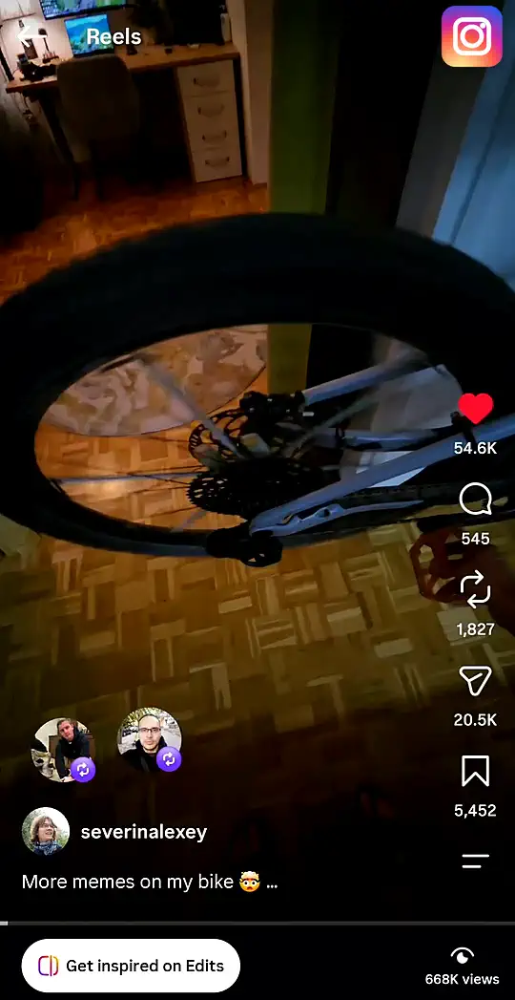
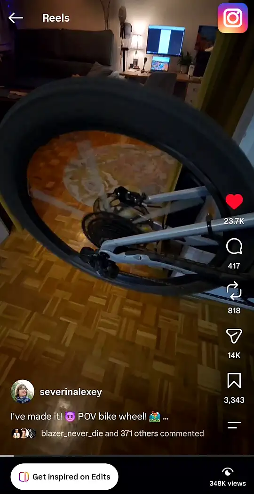
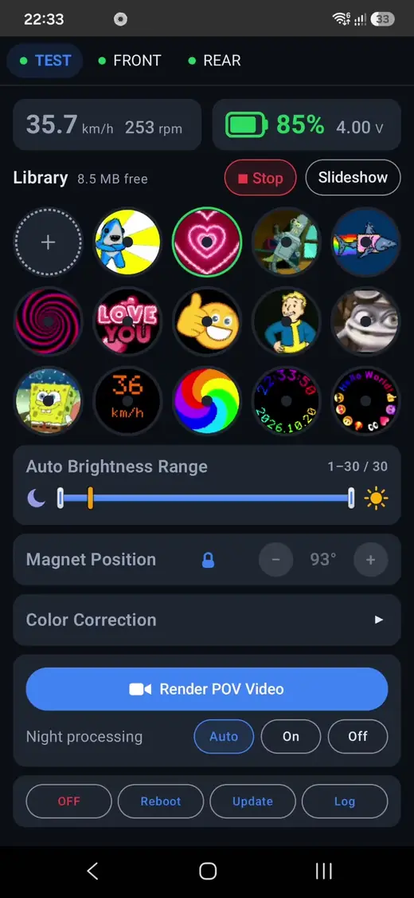
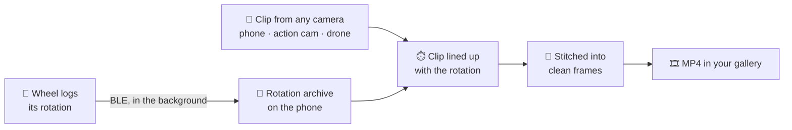

# 🚲 POV Wheel Bike Display

### Turn your bike wheel into a full-colour video screen

A double-sided **Persistence-Of-Vision Display** that lives inside a mountain-bike wheel:
528 LEDs on six spinning arms paint photos, animations, video, a live speedometer, a clock and
your own text right onto bike wheel! You control it from an Android app over Bluetooth.

### 🛒 [povwheel.com](https://povwheel.com/) — Want one? [Join the waitlist](https://povwheel.com/) to be among the first to buy it.

---

## ✨ Highlights

| | |
|---|---|
| 🚵 **Compatible with 20″, 24″, 26″, 27.5″/650B, 29″/700C** | Designed from scratch to fit between the spokes of a bicycle wheel. Works on the **front and the rear wheel**. The wheel detects which way it spins and keeps the image the right way round on both. |
| 💧 **Water-resistant** | Sealed housing made for real rides: rain, mud and puddles. |
| 🔋 **Up to 6 hours of animation** | One charge covers a whole evening ride. A smart battery gauge shows the real remaining percentage. |
| 💤 **Up to a year on standby** | It draws about 10 µA asleep and wakes when you **shake the wheel**. Transport mode ignores vibration completely, so it won't wake up in a car or on a bike rack. |
| 📱 **App over BLE** | Connect **several displays at once** and run a synced slideshow across them. |
| 🎬 **Render POV video from any camera** | Film your ride with a phone, action cam or drone, and the app turns the clip into a clean, flicker-free POV video. |
| 🖼️ **Photos, GIFs, video, text** | Drop in a picture, GIF, animated WebP or MP4. The phone converts it and shows you a preview of exactly what the wheel will display. |
| 🎯 **Sharp, stable image** | 1° angular resolution, sub-degree interpolation, anti-aliasing and acceleration-aware rotor tracking. The picture stays put while you speed up or brake hard. |

---

## 🚵 Compatible with 20″, 24″, 26″, 27.5″/650B, 29″/700C

| | |
|---|---|
| **Display** | **528 RGB LEDs** on 6 arms (27 kHz PWM, 20 MHz clock), double-sided |
| **Image size** | **~55 cm disc** (LED radius 49–273 mm), fits inside a 20″, 24″, 26″, 27.5″/650B or 29″/700C rim |
| **Resolution** | 360 × 44 polar pixels per frame, **256 colours per frame** (own palette for every frame) |
| **Refresh** | Six arms draw the full image every **1/6 of a turn**: 20 Hz at ~28 km/h |
| **Turns on** | from **~10 km/h** (adjustable in the app) |
| **Memory** | up to **~48 s at 10 fps** in RAM, **13 MB** library on flash (up to **800 frames**) |
| **Brains** | ESP32-S3, 16 MB flash, 8 MB PSRAM |
| **Sync** | **6 Hall sensors** (one per arm) + one magnet on the fork or frame |
| **Sensors** | Ambient light (auto-brightness), vibration (wake by shake) |
| **Battery** | 1S6P Li-Po pack **6000 mAh** — with USB Type-C charging, **up to 6 h** display time, **up to 1 year** standby |
| **Enclosure** | Water-resistant, IP54 (dust and splash protected) |

**Both sides are readable.** Text, the clock and the speedometer are mirrored on the far face, so
riders on either side of the bike read them correctly. Logos and pictures can do the same: tick
*Mirror back face* when you upload.

---

## 📱 The app

Everything runs from a handy Android app (Kotlin + Jetpack Compose, Android 8.0+) over Bluetooth LE,
and it can drive several displays at once.

- 📚 **Library.** Your files and effects in one grid, each with an animated round preview that
  matches what the rim shows. Tap to play.
- ➕ **Add anything.** Photos, GIFs, animated WebP and **video** (MP4 / WebM / MOV) with crop or
  fit, fps, start time and length. The phone does the polar transform and the palette
  quantisation. The preview shows the disc exactly as the wheel will.
- ⚡ **Fast upload.** The phone deflate-compresses the file and the wheel unpacks it with the
  decompressor in its ROM. With LE 2M PHY and a credit window instead of per-packet acks, the
  effective speed is 3–5× the raw ~110 kB/s. A CRC32 check means a damaged file is never kept.
- ✍️ **Text editor.** Type a line and it wraps around the rim live as you type. Any system font,
  Cyrillic, smooth anti-aliasing, solid colour or a flowing rainbow.
- 🔁 **Slideshow.** Pick any mix of files and effects. With **two wheels, the slideshow stays in
  sync** across front and rear, and keeps running after you close the app.
- 🎛️ **Display tuning.** Auto-brightness range, magnet position, gamma, contrast, saturation and
  white balance, all applied live.
- 🔋 **Telemetry.** Battery %, charging state, rpm and speed.
- 🛠️ **Maintenance.** Firmware update over Bluetooth, remote power-off into transport mode,
  reboot, device log.

---

## 🎬 Render POV video from any camera

A spinning POV display looks great in person but terrible on camera. A video frame catches only a
slice of the image, so the result flickers and tears. The app fixes this **after the fact**, from
footage shot on **any camera**:

1. **The wheel keeps a diary.** It logs its rotation while you ride, and the app collects the log in
   the background whenever it's connected. A ride without the phone isn't lost.
2. **The app finds the clip in the log.** It lines the recording up with the wheel's rotation
   automatically.
3. **The app stitches clean frames,** keeping resolution and sound. **Slow-mo works too.**

All of this runs on the phone, with no extra hardware and no special camera.

Long-press **Render POV Video** to export the rotation archive or import one from another phone.

---

## 🎨 Built-in effects

<table>
<thead><tr><th>Effect</th><th width="100%">What it does</th></tr></thead>
<tbody>
<tr><td>🏎️&nbsp;<b>Speed</b></td><td>Live speedometer in big digits that shift from green to red as you speed up</td></tr>
<tr><td>🕐&nbsp;<b>Clock</b></td><td>Time along the top of the rim, date along the bottom, solid or rainbow</td></tr>
<tr><td>✍️&nbsp;<b>Text</b></td><td>Your text around the rim, solid or rainbow</td></tr>
<tr><td>🌈&nbsp;<b>Rainbow</b></td><td>Seven colour bands in a flowing spiral, speed and twist set in the app</td></tr>
</tbody>
</table>

Long-press an effect in the app to set it up; the library thumbnail shows it exactly as the rim
will — the real speed, the current time, the chosen colours.

---

## 🔋 Power that lasts

- ⏳ **Up to 6 hours of animation** on one charge.
- 💤 **Up to a year on standby** at ~10 µA, sleeps by itself after a minute idle.
- 👋 **Shake to wake.** Single bumps in a bag or on a rack are ignored.
- 🧳 **Transport mode.** Hold the button 1.5 s or tap *Power off*; one click wakes it.
- 📊 **Honest battery gauge.** No jumps when the display or the charger turns on.
- 🛡️ **Protects the cell.** Dims when low, stops before a deep discharge.

---

## 📄 License

**Free for personal, non-commercial use** under the
[PolyForm Noncommercial License 1.0.0](LICENSE.md): build a wheel for your own bike, study the
code, change it and share your changes.

**Commercial use requires a separate license from the author.** That covers, for example, selling
wheels, kits or pre-flashed boards, or using the firmware, the app or any part of them in a
commercial product or service. To discuss terms, write to
[severin.alexey.r@gmail.com](mailto:severin.alexey.r@gmail.com).

Third-party libraries keep their own licenses.

© 2026 Aleksei Severin
